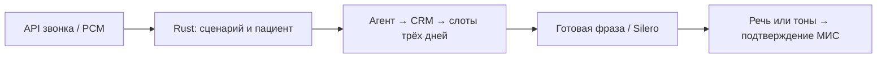

# Голосовой ассистент регистратуры

Интеграция ветки `feature/score-acceptance` (59a2b31) и VM-изменений: **857/857 интеграционных тестов, 29/29 Rust-проверок и 45/45 записей аудиобанка** в изолированном CPU-прогоне без внешней МИС и платных API. Исправлены короткие речевые подтверждения, сохранение времени callback и запуск `audio-check`. [Обезличенный отчёт](debug/runs/score-vm-20261023/public-summary.json).

Состояние развёртывания и границы испытаний: [VM_STATUS.md](docs/acceptance/VM_STATUS.md). Результаты 21–22 октября ниже относятся к предыдущему развёртыванию; новые интеграционные тесты не подменяют повторную телефонную приёмку.

Задача продукта — разгрузить телефонную регистратуру в часы пик: типовые
запись, перенос и отмену выполняет помощник, медицинские и нестандартные
обращения переходят сотруднику с сохранённой историей. По [условию кейса](https://hub.gigaschool.ru/events/tochka-sborki-2026/cases/dbi-voice-clinic)
клиника теряет 30–40% входящих звонков. Для пилота измеряем долю завершённых
типовых обращений, пропуски, ожидание ответа, ошибки записи, неявки и
удовлетворённость. Цели кейса — пропуски до 15%, ожидание до 30 секунд;
производственное достижение этих показателей пока не доказано.

**Актуальная проверка на CPU VM:** полный входящий SIP-звонок с Whisper
организатора создал запись в DBI; отдельный звонок соединён с ответившим
тестовым софтфоном и создал DBI `/escalations`. Исходящее напоминание проверило
карту и приняло голосовое подтверждение. В DBI нет статуса «Подтверждена» —
эта отметка хранится локально. Это тесты на вымышленных пациентах и
синтезированных голосах; работа настоящей смены регистраторов не заявляется.
Браузерная запись клавишами и текстом также принята в отдельной тестовой SQLite.
На предыдущей версии CPU-набор: **770 интеграционных проверок**, без ошибок и пропусков; текущий объединённый набор — 857, см. отчёт выше.
Перенос из напоминания прошёл через настоящий PCM/Whisper/Rust/DBI без SIP-дозвона;
повтор настоящего исходящего переноса после исправления NLU ещё ожидается.
В браузере приняты все шесть WAV-реплик через ASR до настоящего INSERT в тестовую
SQLite. Исправлен выбор «Первый вариант». Физический микрофон пока не принят.
Обезличенный итог: [public-summary.json](debug/runs/hackathon-final/public-summary.json).

Реализация: [Rust HTTP/оркестрация](src/server.rs), [диалоговый движок](src/engine.rs),
[SIP/ARI/AudioSocket](runtime/src/clinic/telephony.py),
[CRM и подтверждённые изменения DBI](runtime/src/clinic/crm.py),
[исходящий модуль](runtime/src/clinic/outbound.py),
[сценарии](scenarios/), [развёртывание и ограничения](deploy/vm/README.md).

**Стенд GIGASCHOOL, 21.10.2026:** установлен CPU-профиль VM, подключены настоящий DBI, командный LLM и SIP-шлюз. Проверены три независимых аудиомаршрута до записи в DBI, перенос/отмена тестового визита и настоящие SIP-звонки. [Запуск, воспроизведение и ограничения](deploy/vm/README.md), [доказательства](debug/runs/vm-deployment/). Браузерный пробник использует отдельную SQLite; доставки SMS и ответа живого оператора эти проверки не подтверждают.

Настройки провайдеров каждого модуля, проверяемая тестовая запись, SQL-журнал, согласие на аудио и граф/импорт разговоров: [ADMIN_MODULES_CALLS.md](docs/ADMIN_MODULES_CALLS.md).

Объединение MILP-ops и calls-arena: Rust исполняет сценарии, ведёт звонки и отдельные ограниченные очереди модулей; Python обслуживает локальные модели, NLU, аудио и SQLite-зеркало МИС. Запись, перенос и отмена завершаются только после подтверждения МИС. Потерянный ответ блокирует спорный слот и создаёт заявку оператору.

Стандартная сквозная демонстрация — `flow=assisted`: карта пациента → специалист → свободное время → голосовое или тоновое подтверждение → подтверждённая запись → СМС. Исходное меню `inbound`, микрофонная песочница наблюдателя и этот маршрут имеют разные задачи. Полное ТЗ ещё не закрыто; условия и незавершённые интеграции перечислены в [GOAL.md](docs/acceptance/GOAL.md) и [TODO.md](TODO.md).



[Разбор одного настоящего debug-пути](docs/DEBUG_WALKTHROUGH.md) показывает входной API, источник каждой реплики, ASR и проверку карты, сценарии с банком фраз и редактором, ограниченный выбор времени, состояние пациента, запись после подтверждения и передачу оператору с тем же запросом/слотами. В нём есть отдельные команды и ссылки на результаты **речи, тонов и смешанного ввода**.

Постоянные подсказки воспроизводятся из банка; выбранная дата/время синтезируются Silero отдельно. Независимые Docker-прогоны нового пути прошли: речь9/тоны0, речь0/тоны17, речь3/тоны14; отчёты и WAV — в `debug/runs/assisted-module/`. По умолчанию выбор слота детерминированный (`model_calls=0`), внешняя LLM подключается отдельно через OpenAI-совместимый шлюз или OpenRouter с локальным ключом. Модель не исполняет произвольный SQL. У DBI нет API полного расписания свободных талонов: live использует импорт с явными идентификаторами врачей и синхронизированные визиты, свежесть которых ограничена пятью минутами.

Отдельный пример распознавания: [фамилии, даты рождения и номера карт](scenarios/docs/IDENTITY.md). Воспроизводимый корпус сохраняет исходный звук, фактический ASR и уточнение при ошибке, включая O’Connor; дата рождения принимается голосом и клавишами.

## Локальный запуск на NVIDIA GPU

```bash
./clinic start --gpu
# Повторный запуск уже собранной версии:
./clinic start --gpu --no-build
./clinic status
# Остановка, рабочие данные остаются в томах:
./clinic stop --backup
```

GPU используется для GigaAM ASR; предзаписанные фразы и предпросмотр Silero пока синтезируются на CPU. Это сохраняет VRAM для распознавания и других программ. Открывайте адрес, который напечатает команда; стандартный интерфейс — http://localhost:8090/registrar. Остановка с сохранением данных: `./clinic stop --backup` (сам бэкап пока заглушка).

Для первого GPU-запуска нужны NVIDIA driver и NVIDIA Container Toolkit, а также полноточный encoder: `python tools/download_models.py --asr --quantization none` в ML-окружении. GPU-библиотеки скачиваются один раз в Docker BuildKit-кэш. Проверка настоящего CUDA-исполнения и ограничения: [LOCAL_GPU.md](docs/LOCAL_GPU.md).

## Запуск без ручного управления Docker

```bash
./clinic start
```

Поднимет главный контейнер, его модули и веб-интерфейс. В конце напечатает действующие адреса и команду остановки. Для одного редактора:

```bash
./clinic start editor
```

Откройте **http://localhost:8090** — администрирование, **http://localhost:8090/registrar** — мастерская регистратора. Если порт изменён, используйте адрес, который напечатала команда. Начальный вход администратора: `admin/admin`; регистратора: `user/user`. Наблюдатель открывает `/registrar` без пароля. Кнопка «Пробный звонок» позволяет говорить в микрофон, слушать ответ и видеть распознанный текст и выбранный шаг. Клавиши выбирают три категории: участковый, узкий специалист, исследования или анализы. Из этого пробного окна записи в МИС не создаются.

Остановка с сохранением данных:

```bash
./clinic stop --backup
# Только редактор:
./clinic stop editor --backup
```

**Резервная копия пока заглушка: она не создаётся.** Команда останавливает контейнеры и сохраняет рабочие данные. Проверка состояния: `./clinic status`. Запуск уже собранной версии без сборки: `./clinic start editor --no-build`. Модели и подключение МИС настраиваются по разделам ниже.

Токен DBI сохраняется только в локальном `.env`. Проверка доступа: `python debug/run_dbi_contract.py`; команда делает один GET врачей, без изменений записей. Подключение VM и актуальный контракт: [STAND.md](docs/STAND.md).

## Запуск главного контейнера

Главный сервис — **`orchestrator`** (Rust). Команда ниже запускает его и отдельные контейнеры зависимостей из `depends_on`, ждёт их healthcheck и готовности оркестратора. Во время звонка Rust обращается к модулям по HTTP во внутренней сети Compose; запуск контейнеров выполняет Compose.

```bash
test -f .env || cp .env.example .env
python3 tools/check_space.py --write-path modules --expected-gib 2
# Один раз: в Python-окружении с requirements/asr.txt и huggingface_hub
python3 tools/download_models.py --tts --asr
# Главный контейнер вместе с необходимыми модулями:
docker compose up --build --detach orchestrator &&
  docker compose up --detach --no-deps --no-build --wait --wait-timeout 240 orchestrator
# Проверка состояния и готовности:
docker compose ps
curl --fail http://127.0.0.1:8080/readyz
docker compose logs --tail=100 orchestrator crm tts asr
```

Запуск разделён на обязательные зависимости и ожидание постоянного сервиса: завершившиеся успешно `audio-init`/`audio-check` не должны ошибочно считаться упавшими контейнерами. `./clinic start` выполняет эти фазы автоматически и печатает адреса.

API: `http://127.0.0.1:8080`; окно регистратора: `http://127.0.0.1:8080/operator`. При изменении `HTTP_PORT` используйте его в URL. В live API требует `Authorization: Bearer …`; `/readyz` остаётся технической проверкой. Настройка SIP ниже запускается отдельным профилем. Завершение: `docker compose down`; данные в именованных томах сохраняются.

Каждый вычислительный модуль имеет собственный контейнер и очередь Rust на **128 запросов с 4 рабочими задачами**. У каждого запроса свои `request_id`, ответ и дедлайн, включающий ожидание в очереди; переполнение отклоняется. Звонки обслуживаются параллельно, состояние пациента изолировано. Лимит 1000 активных сессий — защитный предел, а не доказательство обработки 1000 одновременных разговоров. Схема: [ARCHITECTURE.md](scenarios/docs/ARCHITECTURE.md).

**Пропускная способность:** исходное ТЗ задаёт до 200 звонков в пиковый день, средний разговор 4–5 минут и среднее ожидание до 30 секунд. Лимит стенда — **10 HTTP-запросов в минуту на команду**, поэтому за 10 минут доступно до 100 запросов, включая синхронизацию. Это максимум 100 изменений существующих записей или 50 новых записей, если на каждую нужны создание пациента и визита; фактический результат ниже при прочих запросах. Локальное чтение расписания и предзаписанные фразы уменьшают обращения к дорогим модулям. Расчёт для 12/16/24/32 GiB, формула с ASR/TTS и границы замеров: [CAPACITY.md](docs/CAPACITY.md). Целевые показатели ТЗ нельзя считать достигнутыми по одному healthcheck.

На машине должно оставаться строго **больше 10 GiB на `/home` и 5 GiB на `/`**, в том числе после ожидаемой записи. Проверка: `python3 tools/check_space.py --write-path target --expected-gib 1`. Тяжёлые сборки и тома при необходимости размещайте на своём разделе `/mnt/docker_space`; не меняйте внутренние файлы Docker вручную и не очищайте чужие ресурсы.

## Визуальный редактор сценариев

```bash
./clinic start editor
```

Открыть `http://127.0.0.1:8090`, пароль **admin**. Для последующих запусков готового образа: `./clinic start editor --no-build`. Кэши и отдельный необязательный Rust-сборщик: [BUILD_CACHE.md](docs/BUILD_CACHE.md). Блоки и связи редактируются мышью, условия и клавиши — в формах; есть индексированный поиск, проверка графа, история и сборка версии. Смена пароля, локальный запуск и браузерная приёмка: [EDITOR.md](scenarios/docs/EDITOR.md). Редактор использует отдельную сессию администратора. Изменение сценария сохраняет исходник; новая версия устанавливается пересборкой `orchestrator` после завершения активных звонков.

## Локальная разработка и реальные аудиопроверки

Нужны Rust 1.98, Python 3.12+ и локальные веса. Все речевые проверки используют настоящий Silero и ASR; демо отличается синтетическими данными МИС и имитацией доставки СМС.

```bash
python3 -m venv .venv
. .venv/bin/activate
pip install -r requirements/dev.txt
pip install --index-url https://download.pytorch.org/whl/cpu torch==2.14.1
pip install -r requirements/asr.txt omegaconf==2.3.0
python tools/download_models.py --tts --asr
python tools/dev.py --smoke
python tools/dev.py
```

Логи и тестовая БД: `debug/runs/local-stack/`. Ctrl-C останавливает дочерние процессы. Модель TTS — `modules/tts/models/v5_cis_base.pt` (MIT), голос `ru_ekaterina`. Произношение и проверка всех записей перед сборкой: [SPEECH_QUALITY.md](docs/SPEECH_QUALITY.md). Веса исключены из Git; условия использования: [LICENSES.md](docs/LICENSES.md).

```bash
python debug/run_dtmf_commands.py
python debug/run_speech_commands.py
python debug/run_speech_commands.py --mode combined
python debug/run_speech_roundtrip.py
```

Все прогоны и их результаты находятся в [debug/](debug/README.md). `dtmf-only` передаёт реальные звуковые тоны через production-детектор и арбитр без ASR. `speech-only` передаёт только PCM настоящей речи, без DTMF и подстановки текста. `combined` проверяет оба пути. В `debug/runs/*/audio/` сохраняются WAV для прослушивания. Расширенная проверка речи охватывает скорости 1,3 / 1,5 / 1,75 и G.711.

Исходный `flow=inbound` — DTMF первым. Отдельный `flow=voice` позволяет говорить с первого шага; сквозная демонстрация выбора слота запускается как `flow=assisted`. Исходящий звонок сначала проверяет номер карты; ответ автоответчика или чужого человека не подтверждает запись. Если оператор недоступен, неэкстренное обращение запрашивает удобное время обратного звонка и сохраняется в БД. Экстренные сигналы используют отдельный маршрут.

## Стенд и SIP

Скопируйте `.env.example` в `.env`. Для подключения стенда задайте `APP_MODE=live`, `WITH_ML=1`, `API_TOKEN`, `STAND_URL=https://crm-med-mock.dbi-testing.ru/api/v1`, `STAND_TOKEN`, импорты расписания/пациентов и СМС-шлюз. Затем `./clinic start`. В live отсутствующие модели и токен останавливают соответствующий сервис. API принимает `Authorization: Bearer …`.

Нужен экспорт пациентов и настоящее расписание с **явными doctor_id стенда**. В `data/schedule_grid.json` сохранены демонстрационные допущения исходника, это не подтверждённое расписание организаторов. Контракт: [STAND.md](docs/STAND.md).

Для Asterisk задайте разные длинные `ARI_PASSWORD`, `SIP_PHONE_PASSWORD`, `SIP_OPERATOR_PASSWORD` и выполните `docker compose --profile telephony up --build -d`. Зарегистрируйте SIP-клиент `phone` на порту 5060 и позвоните на **100**. Второй клиент `operator` получает переводы. Настройка транка и сети: [TELEPHONY.md](docs/TELEPHONY.md).

## Проверка

Назначение каждого модуля, условия прохождения и порядок отдельных подписанных коммитов: [план приёмки](docs/acceptance/GOAL.md).

```bash
cargo fmt --all --check
cargo clippy --locked --all-targets -- -D warnings
cargo test --locked
cargo build --locked --bin clinic-voice
python -m pytest tests/integration
python debug/run_legacy_milp.py
(cd runtime && PYTHONPATH=src python -m pytest)
cargo run --release --locked --bin bench-nlu
```

GitHub Actions: тесты, SCA, лицензии Rust, функциональная проверка контейнеров, CycloneDX SBOM. Настоящие речевые команды обязательны в основных тестах и контейнерной приёмке; расширенный замер доступен через workflow `real-local-speech`. Результаты и границы проверки: [VALIDATION.md](docs/VALIDATION.md).

| Путь | Назначение |
|---|---|
| `src/` | Rust VM, HTTP, очереди, корреляция, два классификатора и SQL-планы |
| `scenarios/*.flow` | редактируемые графы, при сборке превращаются в Rust `match` |
| `runtime/src/clinic/` | объединённые адаптеры и настоящие `/clients` + `/visits` |
| `runtime/src/calls/` | DTMF, нормализатор, TTS/ASR и другие модули calls-arena |
| `app/` | сохранённый MILP-ops; используются safety, HTTP-контракты и точный mock МИС |
| `docs/upstream/` | исходные README, лицензия calls-arena, SHA256 обоих архивов |
| `docs/requirements/` | исходное ТЗ и комментарии |

Документы: [архитектура](scenarios/docs/ARCHITECTURE.md), [сборка](docs/BUILD_REQUIREMENTS.md), [эксплуатация](docs/RUNTIME_REQUIREMENTS.md), [ASR / 2026](docs/RESEARCH_ASR_2026.md), [Крылов / Deeray](docs/RESEARCH_KRYLOV.md), [мощность 12/16/24/32 GiB](docs/CAPACITY.md), [соответствие ТЗ](docs/TRACEABILITY.md).

Мастерская регистратора и наблюдателя: `/registrar` на адресе редактора. Временный вход — `user/user`, без входа — просмотр звонков и соседних шагов. Администратор — `admin/admin`. [Работа со звонком и предложением исправления](scenarios/docs/WORKSHOP.md). [Незавершённые задачи](TODO.md).

Панель свободных отзывов и жалоб: после входаadmin/admin нажмите «Отзывы». Ночная сводка использует расписание регистратуры; одобрение сохраняет черновик до проверки развёртывания. [Как это устроено и проверено](docs/FEEDBACK.md).

## Презентация — исходник и сборка


**[Открыть презентацию в браузере](docs/presentations/index.html)** · **[PDF, 11 слайдов](docs/presentations/clinic-voice-assistant.pdf)**

- [PPTX с фиксированной вёрсткой](docs/presentations/clinic-voice-assistant.pptx)
- [Редактируемый PPTX](docs/presentations/clinic-voice-assistant-editable.pptx)
- [Актуальные скриншоты слайдов](docs/presentations/slides/)
- **[Исходник: presentation/deck.json](presentation/deck.json)** — тексты, расположение элементов и тема.
- **[Как редактировать и собирать](presentation/README.md)** — локальный аналог скриптовой сборки слайдов, без Google API.

```bash
npm --prefix presentation ci
npm --prefix presentation run dev    # браузерный просмотр и редактор, порт 8787
npm --prefix presentation run build  # HTML + PDF + PPTX + PNG из одного JSON
npm --prefix presentation test
```

Просмотр в запущенном сервере: `/` — PNG-слайды без JavaScript; `/editor` — редактор.
Пересоберите экспорты после изменения JSON: галерея показывает последнюю сборку.

В редакторе: **«Править» → выбрать элемент → изменить → «Сохранить» → «Экспорт»**.
Сохранение меняет JSON в репозитории; экспорт пересобирает все форматы.
Показатели в презентации разделены на цели пилота и текущие результаты прототипа.

Медицинская граничная реплика: выбор кнопок озвучен явно («нажмите один», «нажмите два»). Проверка `debug/run_medical_boundary_audio.py` читает фразу из действующего сценария и проверяет настоящий Silero → CPU ASR в PCM, A-law и μ-law. Все три маршрута сохранили числа, WER 0; свежий полный аудиобанк 41/41 прошёл. Это автоматическая акустическая проверка, не оценка естественности живыми слушателями.
